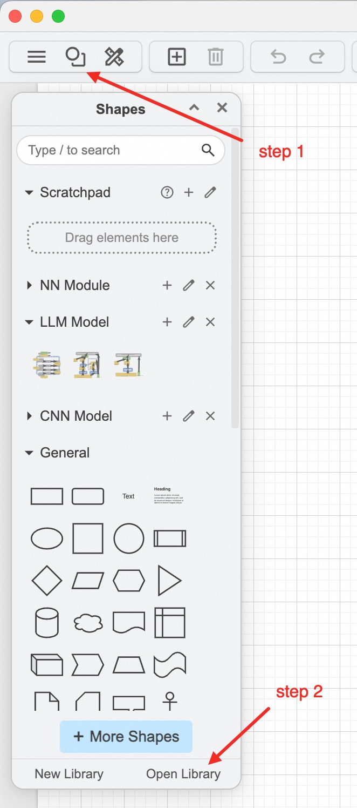

# drawio-nn-templates

A collection of meticulously crafted neural network architecture templates for Draw.io, designed to help you effortlessly design and visualize neural network models. Simply import and use them without the hassle of drawing complex network structures from scratch.

## Features
- **Easy to Import**: Templates are optimized for direct import into Draw.io.
- **Rich Architectures**: Includes common neural network structures such as CNNs, RNNs, LLMs, GANs, and more.
- **Layered Organization**: Templates are organized from basic units to complete model architectures.
- **Highly Customizable**: All templates can be modified and expanded to meet the needs of different projects.
- **Increased Efficiency**: Save drawing time and focus more on model design and optimization.

## Template Library

Templates are organized into three levels — from basic building blocks to complete model architectures:

### NN Basic — Basic Units
Minimal, reusable neural network building blocks.

### NN Module — Reusable Modules
Common sub-structures composed of basic units, reusable across different models.

### Complete Models (by domain)

| Library | Description |
|---------|-------------|
| **CNN Model** | Convolutional Neural Network architectures |
| **RNN Model** | Recurrent Neural Network architectures |
| **LLM Model** | Large Language Model / Transformer architectures |
| **GAN Model** | Generative Adversarial Network architectures |

## Template Catalog

### 📦 NN_Basic.xml
| Template | Description |
|----------|-------------|
| Single-layer Perceptron | Basic single-layer perceptron structure |
| Neural Network (NN) | Fully connected neural network |
| MLP (Multi-Layer Perceptron) | Multi-layer perceptron with hidden layers |
| Embedding Layer | Token/word embedding layer |

### 📦 NN_Module.xml
| Template | Description |
|----------|-------------|
| Auto Encoder (AE) | Encoder-decoder structure for representation learning |
| Restricted BM (RBMs) | Restricted Boltzmann Machines |
| Deep Belief Network (DBN) | Stacked RBMs for unsupervised pre-training |

### 📦 CNN_Model.xml
| Template | Description |
|----------|-------------|
| VGG 16 | 16-layer VGG architecture |
| U-Net | Encoder-decoder with skip connections for segmentation |
| YOLO V1 | You Only Look Once — real-time object detection |
| Deep Convolutional Network (DCN) | Generic deep CNN architecture |
| Action Recognition | CNN-based action recognition pipeline |

### 📦 RNN_Model.xml
| Template | Description |
|----------|-------------|
| Recurrent Neural Network (RNN) | Vanilla RNN with recurrent connections |
| Autoencoder LSTM | LSTM-based autoencoder for sequence modeling |
| 1D Complex-Valued Neural Network (CVNN) | Complex-valued neural network for 1D signals |

### 📦 LLM_Model.xml
| Template | Description |
|----------|-------------|
| DeepSeek V3 | Transformer Block ×L with DeepSeekMoE and Multi-Head Latent Attention (MLA) |
| DeepSeek V4 | Overall architecture — MoE with mHC, CSA/HCA, DeepSeekMoE, MTP |
| DeepSeek V4 CSA | Compressed Sparse Attention with Lightning Indexer |
| DeepSeek V4 HCA | Heavily Compressed Attention for long-context efficiency |

### 📦 GAN_Model.xml
| Template | Description |
|----------|-------------|
| DCGAN Generator | Deep Convolutional GAN generator with fractionally-strided convolutions |
| StyleGAN Generator | Style-based generator with mapping network, AdaIN, and noise injection |
| StyleGAN2 Generator | Improved generator with weight modulation/demodulation (no AdaIN) |

## Quick Start
1. **Download Templates**: Clone or download this repository.
2. **Import into Draw.io**: In Draw.io, select File -> Open Library, then choose the template file you need.
3. **Edit and Customize**: Modify and refine the templates according to your project requirements.

## Acknowledgments
The NN Model part was inspired by and builds upon the work of [Neural-Network-Architecture-Diagrams](https://github.com/kennethleungty/Neural-Network-Architecture-Diagrams). We would like to express our sincere gratitude to the original authors for their valuable contributions to the community.

## Contribution
We welcome issues and pull requests to improve this project. Your contributions will help more developers efficiently design neural network architectures.

## License
This project is open-sourced under the MIT License.

By using these easy-to-import Draw.io neural network architecture templates, you can focus on innovation and optimization of your models without spending time on drawing. Start now and boost your development efficiency!

